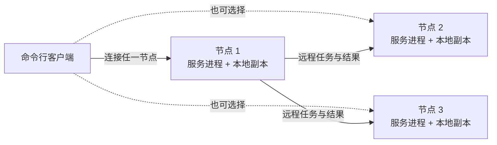
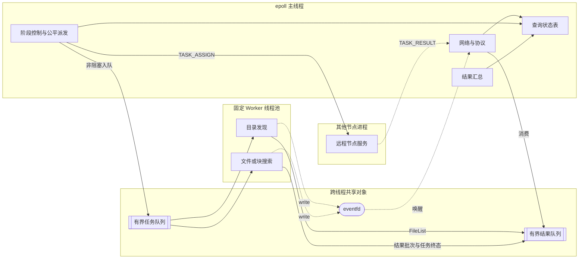
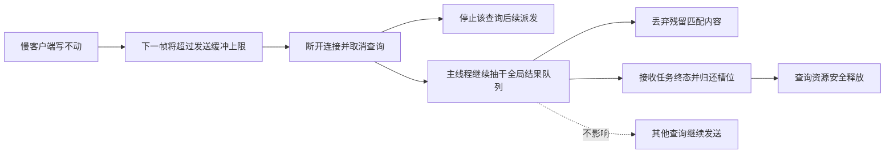
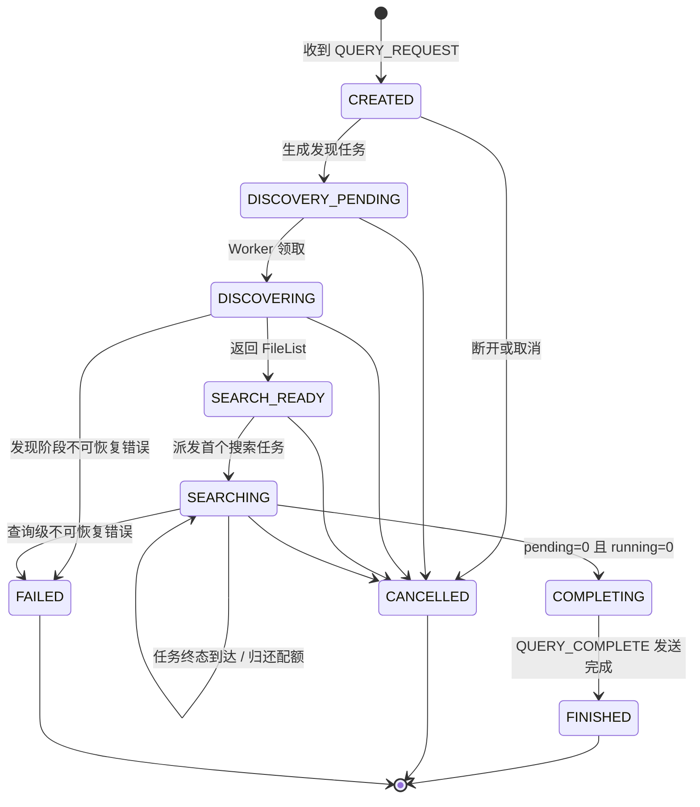
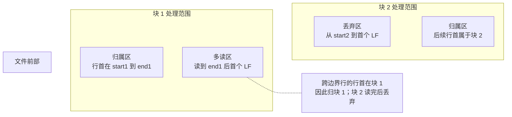
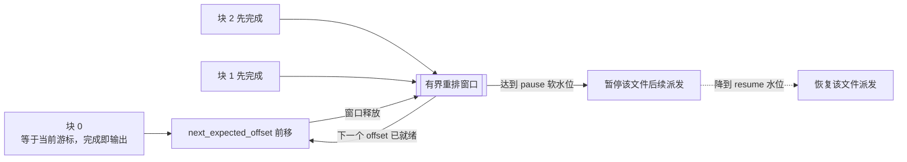
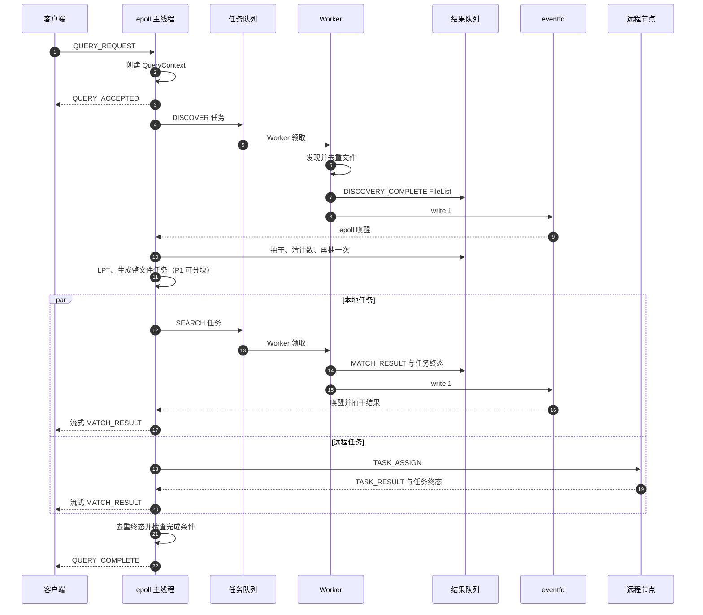
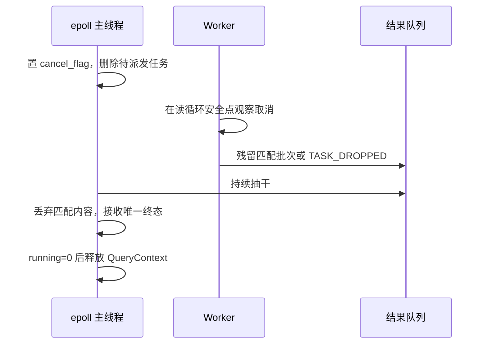

# Linux 操作系统编程：TriSeek 系统设计文档

## 0. 文档信息

| 项目 | 内容 |
|---|---|
| 文档版本 | 1.5 |
| 文档状态 | P0 接口正式冻结版；后续工作转向公共头文件与可执行测试 |
| 项目名称 | TriSeek |
| 实现语言 | C11 / POSIX |
| 目标平台 | Linux |
| 架构主线 | 单 `epoll` 主线程 + 全局固定工作线程池 + 三节点协调者—工作节点 |
| 更新日期 | 2026-09-22 |

### 变更记录

| 版本 | 变更 |
|---|---|
| 1.0 | 初始系统架构、模块划分和查询流程 |
| 1.1 | 根据设计评审统一状态机，补齐线程边界、协议、所有权、取消与故障、拖尾分块、数据语义、接口契约、实验与验收 |
| 1.2 | 根据二次评审引入 P0/P1/P2 优先级；收敛可实现的基础闭环；将分块、自动重试和负载感知等高复杂度机制改为预留设计；补齐边界语义、配置和快速开始 |
| 1.3 | 闭合慢客户端背压链，补回输出格式，增加控制任务优先；修正 P1 重排窗口上限表述，并补齐内存预算、协议一致性和降维实验 |
| 1.4 | 修复单 Worker 槽位、1 TB 查询超时和待派发任务预算；共享模式串；采用混合派发顺序；统一缓冲、转义、统计与 P1 验收口径 |
| 1.5 | 增加远程任务准入和必答终态；隔离进度输出；固化保留槽校验顺序、混合派发顺序和远端查询规格生命周期 |

### 0.1 优先级与实现状态

**优先级：**

| 标记 | 含义 | 进入条件 |
|---|---|---|
| **P0 基础闭环** | 课程要求中必须完成、必须联调、必须验收的功能 | P0 测试全部通过后才能进入性能优化 |
| **P1 课程增强** | P0 后实施的课程重点性能能力；有界分块是最终答辩前的计划交付 | P0 稳定后独立开发、开关控制、专项验收 |
| **P2 可选演进** | 容错或高级性能方向，本课程版本可以不编码 | 不得在报告中宣称已经实现 |

**实现状态：**

| 标记 | 含义 | 判定依据 |
|---|---|---|
| **已实现** | 代码、测试和运行证据均存在 | 以测试报告和提交记录为准 |
| **待实现** | 本版本必须完成，但当前尚无完整代码或验证 | 按里程碑跟踪 |
| **预留** | 只保留设计、配置位或扩展点 | 默认关闭，不计入基础版本验收 |

例如 §7.7.2 当前标记为“P1、预留”，表示它是计划交付方向，但在专项测试通过前仍不能声称已经实现。除非明确标注“已实现”，本文描述的是目标设计而不是当前代码事实。P0 的完成定义见 §10.5；P1/P2 不得成为 P0 查询完成条件的依赖。

---

## 1. 术语表

| 术语 | 英文 | 定义 |
|---|---|---|
| 查询 | Query | 用户提交的一组路径与一个匹配串及其完整生命周期 |
| 协调节点 | Coordinator | 接收客户端查询、分配任务并汇总结果的入口节点 |
| 工作节点 | Worker Node | 为协调节点执行远程搜索任务的其他节点 |
| 工作线程 | Worker Thread | 从本机全局任务队列领取目录发现或搜索任务的固定线程 |
| 查询上下文 | QueryContext | 保存查询状态、任务计数、配额、统计和取消标志的对象 |
| 目录发现任务 | Discover Task | 将路径、目录和通配符展开为去重文件清单的前置任务 |
| 搜索任务 | Search Task | 搜索一个文件或一个大文件块的任务 |
| 待派发任务 | Pending Task | 已具备执行条件，但尚未进入本地队列或远程发送缓冲的任务 |
| 在途任务 | In-flight Task | 已派发但尚未进入唯一终态的本地或远程任务 |
| 任务终态 | Terminal State | `COMPLETE`、`ERROR`、`DROPPED` 三者之一；每个任务只能进入一次 |
| 并行配额 | Per-query Quota | 单个查询允许同时占用的最大在途搜索任务数 |
| 背压 | Backpressure | 下游处理不过来时停止继续派发，使压力逐级向上游传递 |
| 拖尾 | Tail | 查询主体已完成但仍被少数大文件、慢节点或慢任务拖延的现象 |
| LPT | Longest Processing Time First | 按预计工作量从大到小分配任务的贪心策略 |
| 全局查询编号 | Global Query ID | 高 16 位为协调节点编号、低 48 位为本节点递增序号的 64 位标识 |

---

## 2. 需求、范围与数据语义

### 2.1 课程需求

- 支持 10 个用户各自独立、并发检索；
- 单机阶段不少于 1000 个文件，单文件约 10 KB～10 GB，总量超过 100 GB，分布在 10 个目录；
- 用户通过命令行指定一个或多个目录、递归子目录或带引号的通配符，并指定固定匹配字符串；
- 输出匹配文件名、行号、完整行、匹配文件总数和匹配行总数；
- 检索任务并行执行，并说明并行度、公平性和拖尾处理；
- 三机阶段约 10000 个文件、1 TB、20 个目录，三台服务器保存相同目录和内容副本；
- 每台服务器运行同一检索服务，使用 TCP Socket 和自定义协议；
- Shell 脚本在三台服务器模拟总计 10 个用户，每个用户循环随机选择 1～2 个目录和一个随机匹配串，每次查询写独立日志。

### 2.2 数据规格

| 阶段 | 目录数 | 文件数 | 单文件范围 | 总量 | 副本 |
|---|---:|---:|---:|---:|---|
| 单机阶段 | 10 | ≥1000 | 10 KB～10 GB | >100 GB | 1 份 |
| 三机阶段 | 20 | 约10000 | 10 KB～10 GB | 约1 TB | 三台各一份相同副本 |

测试数据生成器或适配脚本按以下命令契约提供，命令、测试和报告统一采用相同口径。`--files` 明确定义为**整个数据集的总文件数**，不是每目录文件数：

```bash
triseek-data-gen --root /data/triseek \
  --dirs 10 --files 1000 \
  --min-size 10KB --max-size 10GB \
  --total-size 110GB --seed 20260922
```

三机阶段三台使用相同参数和种子，并输出 `manifest.tsv`。部署前比较三份 manifest 的哈希，确认相对路径、大小和内容摘要一致。

如果复用外部 `.NET 9` 版 `WordDataFactory`，三台 Linux 机器必须安装对应运行时，只能使用跨平台参数；NTFS `--compress`、Windows 盘符和 PowerShell 自测脚本不能进入 Linux 流程。仓库内须提供 POSIX Shell 薄包装，将默认根目录改为 `/data/triseek`，映射真实参数，并记录工具版本或提交号。若小组不接受额外运行时，则在 M0 确定改写一个 POSIX/C 生成器。外部工具未纳入仓库和自动化测试前，不标记为本项目“已实现”。三机推荐参数为 `--dirs 20 --files 10000 --total-size 1TB`。

### 2.3 行与匹配语义

- 只以 LF 字节 `0x0A` 分隔行；
- CRLF 中 LF 负责分行，输出前剥离行尾单个 CR；
- 孤立 CR 视为行内普通字节，不单独分行；
- 最后一行没有 LF 仍然是一行；
- 固定字节串匹配，默认区分大小写，不支持正则；
- 同一行出现多次匹配串仍计为一条匹配行；
- 匹配在完整逻辑行上执行，4 KiB 上限只影响输出显示，不能导致长行后半段的匹配被漏掉；
- 对 CRLF 行先在包含行尾 CR 的原始行字节上匹配，再仅为显示剥离末尾单个 CR，与 `grep` 的字节匹配口径一致；
- `matched_files` 按 `(st_dev, st_ino)` 去重，硬链接只计一个文件，并显示目录发现时首次遇到的路径；
- 默认流式输出，不保证跨文件顺序；测试时排序后与基准结果比较；
- 路径中的控制字符和换行在输出中转义；
- 单行显示从原始逻辑行最多取前 4 KiB，超出部分截断并附加 `...(truncated)`；转义后最坏可膨胀到原始字节数的4倍，必须计入批次和发送预算；
- 匹配实现按字节长度处理，不使用会在 NUL 处停止的 `strstr/strlen` 搜索文件内容。
- 除明确写作“原始行截断阈值”的4 KiB外，协议体、结果批次、队列和发送缓冲的所有字节上限均指编码后的线上字节数。

### 2.4 明确不做

- 用户认证与权限系统；
- 协调节点故障后的查询迁移和续传；
- 跨查询结果缓存；
- 跨机搬运原始大文件；
- 动态扩缩容；
- 多 Reactor 网络线程。

#### 2.4.1 P0 部署前提假设

- 检索数据位于本地块设备，不支持可能永久阻塞的 hung NFS/FUSE 挂载；目录发现无法安全中断时由部署约束保证；
- 三台机器的数据根目录结构一致，并在运行前完成离线 manifest 校验；
- P2 再研究隔离进程、可中断发现和在线副本拒绝机制。

### 2.5 版本范围与功能优先级

基础闭环不是“功能最少”，而是从请求进入到结果返回、异常退出和资源回收都能被验证的最小完整系统。

| 优先级 | 功能 | 本文实施口径 |
|---|---|---|
| P0 | 单机请求闭环 | 客户端请求、协议解析、目录发现、整文件搜索、流式结果、最终统计 |
| P0 | 并发闭环 | 单 `epoll` 主线程、一个固定 Worker 池、有界任务/结果队列、`eventfd`、10 用户隔离 |
| P0 | 调度闭环 | 每查询待派发队列、轮询公平派发、并行配额、队列满时非阻塞返回 |
| P0 | 生命周期闭环 | 唯一任务终态、取消、局部错误、连接断开、查询释放、优雅退出 |
| P0 | 三节点基本闭环 | 任意节点协调、以文件为单位静态 LPT 分配、远程执行、结果汇总；节点故障时查询明确失败，不自动迁移 |
| P0 | 测试闭环 | 小数据正确性对照、10 用户脚本、单机/三机结果一致、资源无泄漏 |
| P1 | 有界大文件分块 | 文件内有限在途块、有界重排、高命中率降级；默认关闭，但作为课程“解决拖尾”的计划交付 |
| P1 | 性能验证 | 分块前后 makespan 对比、冷/热缓存和低/高命中率分组结论 |
| P2 | 可选容错 | 心跳、失联检测、远程任务有限重试和重派、在线 manifest 拒绝 |
| P2 | 高级演进 | 加权负载感知、临时文件 spill、协调者故障迁移、动态线程数、工作窃取、多 Reactor |

P0 三机版本不依赖分块和自动重试：即使某个文件很大，也按一个完整文件任务执行。它能正确完成课程功能，但最大文件仍决定拖尾下界。P1 有界分块用于完成课程点名的拖尾优化；心跳与自动重试仍留在 P2，不与分块捆绑实施。

### 2.6 需求追溯矩阵

| 课程要求 | 设计章节 | 验证方式 |
|---|---|---|
| 10 用户独立并发 | §4、§7.4、§9.3 | 10 用户脚本，检查统计与日志不串扰 |
| 大规模文件 | §2.2、§7.6、§7.7 | 文件计数、总字节、整文件流式扫描、RSS 上限 |
| 文件名/行号/整行/统计 | §2.3、§7.7、§7.9 | 与 `grep -n --fixed-strings` 语义对照 |
| 并行度与拖尾 | §7.4、§8.4、§9 | P0 用 LPT 与公平调度缓解；P1 分块后再做 makespan 对比 |
| 三机协同 | §3.2、§7.8、§8.6 | 三节点日志、任务唯一终态、副本校验 |
| 自定义协议 | §5 | 协议编解码、半包/粘包/非法帧测试 |
| Shell 模拟用户 | §10.3 | 三台按 3/3/4 用户运行并生成独立日志 |

---

## 3. 总体架构

### 3.1 架构选择

TriSeek 采用三层组合架构：

1. 客户端—服务端：命令行客户端通过 TCP 连接任一节点；
2. 单机内部：单 `epoll` Reactor + 有界生产者—消费者队列 + 固定线程池；
3. 集群内部：入口节点担任本查询协调节点，另外两台作为工作节点。

选择线程而不是进程，是因为任务和结果需要共享查询状态与队列，线程创建和通信成本较低；代价是必须严格定义对象所有权和同步边界。进程崩溃隔离更好，但共享状态和 IPC 更复杂，不作为课程第一版方案。

### 3.2 部署视图

三台服务器运行完全相同的二进制和节点配置。客户端连接哪台，哪台就是本查询协调节点。



节点 1 只表示本次查询选择的入口，下一次查询可以由节点 2 或节点 3 协调。

### 3.3 第一设计原则：单线程拥有控制状态

> 所有 Socket 状态、查询状态、任务计数、配额、发送缓冲和最终统计只由 `epoll` 主线程修改。

Worker 不直接修改这些对象，只返回带 `query_id` 和 `task_id` 的结果。该原则通过代码评审和静态搜索验证：Worker/搜索模块中不得出现 `send`、`recv`、`epoll_ctl`，网络模块中不得出现目录遍历和文件扫描。

### 3.4 线程与资源视图



每个服务进程只有一个主线程和一个全局工作线程池。查询到达时只创建查询对象和任务，不创建新线程。

### 3.5 队列与背压

系统包含：

- 每查询待派发任务列表：仅由主线程操作，不需要锁；
- 远程入向待准入列表：仅由主线程操作，受 `remote_pending_cap` 限制；
- 全局有界任务队列：主线程非阻塞入队、Worker 阻塞出队；
- 全局有界结果队列：Worker 入队、主线程出队；
- 每连接接收缓冲：保存未组成完整协议帧的数据；
- 每连接发送缓冲：保存尚未发送完成的数据。

主线程绝不阻塞等待任务队列空间。队列满时停止本轮派发并返回事件循环。全局结果队列同时受条目数和总字节数限制，任一先到即满。

P0 对慢客户端采用“有界并立即终结”的策略：若下一帧会使该连接发送缓冲超过 `send_buf_cap`，主线程不再把该帧加入发送缓冲，而是立即关闭连接并取消其全部查询。此后主线程仍持续抽干全局结果队列；凡属于已取消或已移除查询的匹配批次，直接释放内容，只接收其任务终态用于归还槽位和完成资源结算。不得停止消费全局结果队列，也不得把匹配结果转移到另一个无上限缓冲。



背压闭环必须同时满足：每次成功 push 结果后都写 `eventfd`；主线程每次唤醒抽干结果队列；取消后仍消费并释放残留结果；发送上限和写无进展超时均能触发断开。这样 Worker 即使暂时阻塞在满队列上，也会随着主线程抽干而继续，不会被单个慢查询永久拖住。

---

## 4. 并发、状态与生命周期

### 4.1 查询状态机

系统只保留以下一套状态定义：



### 4.2 状态迁移表

| 当前状态 | 事件 | 动作 | 执行线程 | 下一状态 |
|---|---|---|---|---|
| CREATED | 请求校验完成 | 生成发现任务放入查询队列 | epoll | DISCOVERY_PENDING |
| DISCOVERY_PENDING | 获得槽位并入全局队列 | 记录控制任务在途 | epoll | DISCOVERING |
| DISCOVERING | `DISCOVERY_COMPLETE` | 排序、LPT、生成整文件任务；P1 可分块 | epoll | SEARCH_READY |
| SEARCH_READY | 派发首个搜索任务 | `running++` | epoll | SEARCHING |
| SEARCHING | 任务终态到达 | 去重计数、归还配额 | epoll | SEARCHING |
| SEARCHING | `pending=0 && running=0` | 生成最终统计 | epoll | COMPLETING |
| COMPLETING | 完成帧发送完毕 | 移出查询表并释放 | epoll | FINISHED |
| 任意非终态 | 客户端断开/取消 | 置取消、剩余任务记 `DROPPED` | epoll | CANCELLED |
| 任意非终态 | 不可恢复错误 | 终结剩余任务并返回错误 | epoll | FAILED |

### 4.3 所有权与同步

| 对象 | 唯一写入者 | 读取者 | 保护方式 | 释放时机 |
|---|---|---|---|---|
| `Connection` | epoll 主线程 | epoll 主线程 | 无锁 | 连接关闭且发送资源释放 |
| `QueryContext` 状态/计数 | epoll 主线程 | epoll 主线程 | 无锁 | 进入终态并无在途结果 |
| 查询级 `pattern` | epoll 主线程创建后只读 | Worker/协议编码 | `SearchTask` 非拥有引用 | 所有待派发与在途任务结算后随查询释放 |
| `cancel_flag` | epoll 主线程 | Worker | `_Atomic bool` | 查询释放 |
| 每查询待派发列表 | epoll 主线程 | epoll 主线程 | 无锁 | 查询结束 |
| 远程入向待准入列表 | epoll 主线程 | epoll 主线程 | 无锁、有界 | 派发、拒绝或节点连接关闭 |
| 全局任务队列 | epoll 入、Worker 出 | 双方 | mutex + cond，有界 | 服务停止 |
| 全局结果队列 | Worker 入、epoll 出 | 双方 | mutex + cond，有界 | 服务停止 |
| `eventfd` | Worker 写 | epoll 读 | 内核计数 | 服务停止 |

`SearchResult` 只携带 `query_id` 和 `task_id`，不携带裸 `QueryContext*`。主线程按 ID 查表，避免 Worker 持有已释放查询指针。

### 4.4 任务唯一终态与完成条件

每个搜索任务恰好进入一次：

```text
TASK_COMPLETE | TASK_ERROR | TASK_DROPPED
```

P0 的强不变量是：每个本地已提交任务，以及工作节点收到的每个 `TASK_ASSIGN`，最终都必须恰好对应一个系统可见终态，包括准入时被拒绝的任务。工作节点能够通信时返回 `TASK_TERMINAL`；若终态发送前连接断开，协调节点必须为该连接的所有未结算任务合成 `TASK_ERROR`，不能继续等待网络消息。

协调节点按 `(query_id, task_id)` 去重，重复或迟到的终态不重复计数。查询维护：

```text
discovery_done
total_search_tasks
pending_search_tasks
running_search_tasks
finished_search_tasks
dropped_search_tasks
```

查询正常或带部分失败完成的条件是：

```text
discovery_done
&& pending_search_tasks == 0
&& running_search_tasks == 0
&& finished_search_tasks + dropped_search_tasks == total_search_tasks
```

取消时，尚未派发任务转为 `DROPPED`；在途任务通过取消标志或远程取消进入终态；任何退出路径都必须归还并行槽位。

### 4.5 `epoll` 与 `eventfd` 约定

- 使用 LT 模式，降低第一版实现风险；
- `accept4(SOCK_NONBLOCK | SOCK_CLOEXEC)` 循环到 `EAGAIN`；
- 所有 Socket 非阻塞，并设置 `SO_REUSEADDR`；
- `recv` 循环到 `EAGAIN`，`EINTR` 重试；
- `send` 使用 `MSG_NOSIGNAL`，部分写保留剩余数据；
- 发送缓冲清空后取消 `EPOLLOUT`，防止忙转；
- `eventfd` 使用普通计数模式，不使用 `EFD_SEMAPHORE`；
- Worker 每次成功向结果队列 push 后执行一次非阻塞 `eventfd` 写；若计数已饱和而返回 `EAGAIN`，fd 本身已处于可读状态，不得阻塞重试；
- 唤醒处理采用“抽干结果队列 → 读取 eventfd → 再抽一次结果队列”；
- 使用 `signalfd` 处理 `SIGINT/SIGTERM`，信号处理函数不做复杂清理。

### 4.6 优雅退出（P0）

```text
停止 accept
→ 标记全部查询取消
→ 终结未派发任务
→ 关闭任务队列并 broadcast
→ Worker 退出并 join
→ 消费或释放剩余结果
→ 关闭节点连接、客户端连接、eventfd、epoll 和监听 fd
```

正常退出等待 Worker 的上限为 `shutdown_timeout_ms`。P0 数据只允许位于本地块设备；若超过上限仍未退出，记录未完成任务和线程信息后由进程退出，不承诺在同一进程内强制终止单个线程。

---

## 5. 自定义协议规范

### 5.1 帧结构

所有整数使用网络字节序，字符串为不带 NUL 的 UTF-8 字节序列。固定头为 32 字节：

| 偏移 | 长度 | 字段 | 说明 |
|---:|---:|---|---|
| 0 | 2 | `magic` | `0x5453`，非本协议立即断开 |
| 2 | 1 | `version` | 当前为 1 |
| 3 | 1 | `type` | `TS_MSG_*` |
| 4 | 2 | `flags` | bit0 LAST、bit1 ERROR、bit2 REGISTER，其余必须为 0 |
| 6 | 2 | `header_len` | 固定为 32 |
| 8 | 4 | `body_len` | 不超过 1 MiB |
| 12 | 8 | `query_id` | 控制请求创建前可为 0 |
| 20 | 8 | `task_id` | 控制消息填 0 |
| 28 | 4 | `reserved` | 发送方清零、接收方忽略 |


全局 `query_id` 的高 16 位为协调节点编号，低 48 位为协调节点本地递增序号。`task_id` 在查询内唯一。

接收端必须逐字段解码：用 `memcpy` 拷贝到对齐的局部变量后转换字节序，或逐字节移位组装。禁止把接收缓冲区直接强制转换为协议结构体指针，因为 `query_id` 位于偏移 12，既可能未按 8 字节对齐，也存在结构体填充、严格别名和主机字节序问题。`header_len` 用于未来版本跳过已识别长度之后的扩展头；P0 只接受 32。

### 5.2 解析状态机

每个连接维护独立接收缓冲和解析状态：

```text
WAIT_HEADER
→ 收满 32 字节并校验
→ WAIT_BODY
→ 收满 body_len
→ DISPATCH
→ WAIT_HEADER
```

超过最大消息体、未知版本、未知类型、保留位非零或长度不一致均返回协议错误并关闭连接。

### 5.3 消息矩阵

| 消息 | 方向 | 消息体核心字段 |
|---|---|---|
| `QUERY_REQUEST` | 客户端→节点 | 路径数、各路径长度与字节、匹配串长度与字节 |
| `QUERY_ACCEPTED` | 节点→客户端 | 全局 `query_id`、服务端 `progress_interval_ms` |
| `MATCH_RESULT` | 节点→客户端 | 文件标识、行号、行长度、行内容 |
| `QUERY_PROGRESS` | 节点→客户端 | 已结算任务数、当前 `bytes_scanned`；按 `progress_interval_ms` 或每个任务终态后发送 |
| `QUERY_COMPLETE` | 节点→客户端 | `matched_files`、`matched_lines`、`failed_tasks`、`dropped_tasks`、`skipped_paths`、`bytes_scanned`、`first_result_ms`、`total_ms` |
| `ERROR_RESPONSE` | 双向 | 状态码、错误文本 |
| `TASK_ASSIGN` | 协调→工作节点 | 路径、offset、length、匹配串、attempt；P0 固定为 `0/file_size/0`；该节点首个任务置 REGISTER 并登记远端规格，后续值必须一致 |
| `TASK_RESULT` | 工作→协调 | 结果批次、块内信息 |
| `TASK_TERMINAL` | 工作→协调 | COMPLETE/ERROR/DROPPED、错误码 |
| `NODE_HEARTBEAT`（P2） | 节点间 | 节点编号、时间、空闲槽位 |
| `CANCEL_QUERY` | 协调→工作节点 | `query_id` |
| `QUERY_RELEASE` | 协调→工作节点 | `query_id`；所有远程任务结算后释放只读查询规格 |

单请求最多 64 个路径，路径总字节不超过 256 KiB，匹配串长度必须为 1～4 KiB。用户应给通配符加引号，避免 Shell 预先展开成大量参数。

### 5.4 错误码

| 错误码 | 含义 |
|---|---|
| `TS_OK` | 成功 |
| `TS_E_NOENT` | 路径不存在 |
| `TS_E_ACCES` | 权限不足 |
| `TS_E_IO` | 文件或网络 I/O 错误 |
| `TS_E_BADPROTO` | 协议格式或版本错误 |
| `TS_E_TOO_LARGE` | 请求、消息体或客户端排序缓存超过上限；超长行只截断显示，不返回此错误 |
| `TS_E_CANCELED` | 查询取消 |
| `TS_E_TIMEOUT` | 远程任务或客户端写超时 |
| `TS_E_BUSY` | 服务达到查询或队列上限 |

---

## 6. 核心数据结构与接口契约

### 6.1 头文件与模块

| 文件 | 责任 |
|---|---|
| `protocol.h` | 协议头、消息类型、编解码 |
| `connection.h` | 连接缓冲和解析状态 |
| `query.h` | 查询状态、计数和统计 |
| `task.h` | 发现任务、文件/块搜索任务 |
| `result.h` | FileList、匹配批次、任务终态 |
| `blocking_queue.h` | 有界跨线程队列 |
| `thread_pool.h` | 固定 Worker 生命周期 |
| `scheduler.h` | 阶段控制、公平派发、配额 |
| `discovery.h` | 目录发现与文件元数据 |
| `search.h` | 流式文件/块搜索 |
| `distributed.h` | 节点状态、LPT、远程任务 |
| `server.h` | 服务进程、epoll 主循环 |

### 6.2 关键字段

`QueryContext` 由主线程创建、写入和释放；Worker 只能读取原子取消标志的稳定引用。

| 字段 | 类型示意 | 写入者/读取者 | 生命周期与说明 |
|---|---|---|---|
| `query_id` | `uint64_t` | 主线程/全模块只读 | 查询创建后不变 |
| `state` | `ts_query_state_t` | 主线程/主线程 | 查询状态机 |
| `cancel_flag` | `_Atomic bool` | 主线程/Worker | 查询退出前保持有效 |
| `spec` | `ts_query_spec_t` | 主线程/发现与搜索只读 | 深拷贝路径和模式串 |
| `discovery_done` | `bool` | 主线程/主线程 | 发现终态到达后置位 |
| `pending/running/finished/dropped` | `uint64_t` | 主线程/主线程 | 任务完成条件计数 |
| `quota` | `uint32_t` | 主线程/调度器 | 单查询在途上限 |
| `pending_tasks` | intrusive list | 主线程/主线程 | 查询释放时必须为空 |
| `stats` | `ts_query_stats_t` | 主线程/主线程 | 匹配、错误和耗时统计 |

`SearchTask` 的所有权从主线程转移到任务队列，再转移到 Worker；Worker 产生唯一终态后释放任务。

| 字段 | 类型示意 | 写入者/读取者 | 生命周期与说明 |
|---|---|---|---|
| `kind` | `ts_task_kind_t` | 主线程/Worker | `DISCOVER` 或 `SEARCH_FILE`；P1 才有 `SEARCH_CHUNK` |
| `query_id/task_id` | `uint64_t` | 主线程/全模块只读 | 联合标识任务 |
| `path` | owned byte string | 主线程/Worker | 任务自有，允许非 NUL 语义边界 |
| `dev/ino/size` | fixed integers | 发现结果/Worker | 文件身份与预计工作量 |
| `offset/length` | `uint64_t` | 主线程/Worker | P0 整文件为 `0/size`；P1 用于块 |
| `pattern_ref` | `const ts_pattern_t *` | 主线程赋值/Worker 只读 | 非拥有引用，指向 `QueryContext.spec.pattern`，禁止逐任务复制 |
| `attempt` | `uint32_t` | 主线程/远程节点 | P0/P1 固定为 0；P2 重试使用 |

任务对 `pattern_ref` 的引用安全性来自生命周期顺序：主线程只有在待派发列表为空、所有在途任务进入唯一终态后才释放 `QueryContext`，因此任何任务的生命周期都短于查询级模式串。`SearchResult` 从 Worker 转移到结果队列，再由主线程消费和释放。

| 字段 | 类型示意 | 写入者/读取者 | 生命周期与说明 |
|---|---|---|---|
| `kind` | `ts_result_kind_t` | Worker/主线程 | FileList、匹配批次、扫描进度或终态 |
| `query_id/task_id` | `uint64_t` | Worker/主线程 | 不包含 `QueryContext*` |
| `payload` | tagged union | Worker/主线程 | 结果对象所有权随队列转移 |
| `terminal` | `ts_task_terminal_t` | Worker/主线程 | 只允许一次有效终态 |
| `error_code` | `ts_error_t` | Worker/主线程 | 成功为 `TS_OK` |

### 6.3 核心接口

```c
int ts_protocol_try_decode(ts_byte_buffer_t *in, ts_message_t *out);
int ts_protocol_encode(const ts_message_t *msg, ts_byte_buffer_t *out);

int ts_queue_try_push(ts_blocking_queue_t *q, void *item);
int ts_queue_pop(ts_blocking_queue_t *q, void **item);
void ts_queue_close(ts_blocking_queue_t *q);

int ts_thread_pool_submit_nowait(ts_thread_pool_t *pool, ts_search_task_t *task);

int ts_discover_files(const ts_query_spec_t *spec, ts_file_list_t *out);
int ts_search_task_execute(const ts_search_task_t *task,
                           const _Atomic bool *cancel,
                           ts_result_sink_fn sink,
                           void *sink_arg);

int ts_scheduler_add_query(ts_scheduler_t *s, ts_query_context_t *q);
size_t ts_scheduler_dispatch(ts_scheduler_t *s, size_t budget);
void ts_scheduler_on_result(ts_scheduler_t *s, const ts_search_result_t *r);
void ts_scheduler_cancel(ts_scheduler_t *s, uint64_t query_id);
```

约定：主线程调用的提交接口不得阻塞；返回值统一为 `TS_OK` 或错误码；任务成功进入队列后所有权转移给队列/Worker，失败时仍归调用者。

### 6.4 配置参数

| 参数 | 初始默认值 | 说明 |
|---|---:|---|
| `listen_addr` | `0.0.0.0` | 服务监听地址 |
| `port` | 按节点配置 | 客户端和节点连接端口 |
| `node_id` | 必填 | 1～65535，三节点唯一 |
| `workers` | `min(ncpu,16)` | 由饱和点实验修正 |
| `task_queue_cap` | 256 | 本机已获执行资格任务上限 |
| `result_queue_cap` | 256 | Worker 结果上限 |
| `result_queue_bytes_cap` | 16 MiB | 结果负载总字节上限，与条目上限同时生效 |
| `remote_pending_cap` | 128 | 已接收但尚未进入本机任务队列的远程任务上限 |
| `send_buf_cap` | 4 MiB/连接 | 慢客户端保护 |
| `recv_buf_cap` | 1 MiB + 64 B/连接 | 可容纳32字节头和最大消息体，并留少量余量 |
| `max_queries` | 32 | 达到上限时以 `TS_E_BUSY` 拒绝新查询 |
| `per_query_quota` | 2 | 单查询最大在途搜索任务 |
| `min_quota` | 1 | 动态配额下界 |
| `max_quota` | 8 | 动态配额配置上界，运行时再裁剪到搜索槽数 |
| `dispatch_budget` | 32 | 主线程每轮最多派发任务数 |
| `reserved_control_slots` | 1 | 为目录发现保留的 Worker 槽位 |
| `control_burst_limit` | 8 | 连续控制任务上限，防止搜索反向饥饿 |
| `client_sort_max_results` | 100000 | `--sort` 模式最大缓存结果条数 |
| `client_sort_max_bytes` | 64 MiB | `--sort` 模式最大编码结果字节数 |
| `enable_chunking` | `false` | P1 分块总开关；P0 必须关闭 |
| `large_file_threshold` | 256 MiB | P1：超过后分块 |
| `chunk_size` | 64 MiB | P1：大文件目标块大小 |
| `max_inflight_chunks_per_file` | 2 | P1：单文件最多在途块数 |
| `reorder_pause_bytes` | 8 MiB | P1：单文件重排缓冲暂停派发软水位 |
| `reorder_resume_bytes` | 4 MiB | P1：低于此水位才恢复，形成滞回 |
| `high_match_fallback_ratio` | 0.5 | P1：输出字节超过文件比例后降级顺序扫描 |
| `task_timeout_ms` | 30000 | P2：远程任务无进展超时初值 |
| `client_write_timeout_ms` | 60000 | 客户端写无进展超时 |
| `client_query_timeout_ms` | 1800000 | 客户端查询墙钟安全上限，默认30分钟 |
| `client_stall_timeout_ms` | 60000 | 连续无结果或进度更新的看门狗 |
| `progress_interval_ms` | 20000 | 长任务扫描进度上报周期，必须小于stall超时的一半 |
| `heartbeat_interval_ms` | 1000 | P2：节点心跳间隔 |
| `heartbeat_miss_limit` | 3 | P2：连续丢失次数达到此值判失联 |
| `max_retries` | 2 | P2：仅远程任务最大重试次数 |
| `shutdown_timeout_ms` | 5000 | 优雅退出等待 Worker 的上限 |

默认值只用于首轮运行，最终值以 §9 实验结果为准。

启动计算和校验必须按以下顺序进行，不能先用原始 `reserved_control_slots` 拒绝单Worker配置：

```text
要求 workers >= 1
effective_reserved = min(reserved_control_slots, max(0, workers - 1))
search_slots = max(1, workers - effective_reserved)
校验 effective_reserved <= max(0, floor(workers / 2))
校验 min_quota <= max_quota
校验 reorder_resume_bytes < reorder_pause_bytes
服务端校验 progress_interval_ms > 0
```

客户端收到 `QUERY_ACCEPTED` 后校验 `progress_interval_ms < client_stall_timeout_ms / 2`；不满足时立即报配置不兼容，而不是运行到中途误判超时。

运行时实际配额再取 `min(configured_max_quota, search_slots)`，因此配置中的 `max_quota` 可以高于某次小 Worker 实验的搜索槽数，但不会造成超派发。

若接收存储为定长数组，编译期使用 `_Static_assert(TS_RECV_STORAGE_CAP >= TS_MAX_BODY + TS_HEADER_SIZE, "receive buffer too small")`；若按配置动态分配，则启动时执行同一关系的运行时校验。1 MiB 消息体上限主要为批量结果留余量，普通请求的实际最大体积约为路径总量256 KiB加模式串及字段开销。

---

## 7. 模块详细设计

### 7.1 命令行客户端

客户端解析 `--server`、`--port`、多个 `--path`、`--pattern` 和可选 `--sort`。通配符必须加引号。默认流式输出。标准输出格式固定为：

```text
<escaped_path>:<line_no>:<escaped_line_text>
matched_files=<n> matched_lines=<n> failed_tasks=<n> dropped_tasks=<n> skipped_paths=<n> bytes_scanned=<n> first_result_ms=<n> total_ms=<n>
```

路径和行内容中的冒号、反斜杠、CR、LF及不可打印控制字节使用反斜杠转义。编码顺序固定为：先把 `\` 编码为 `\\`，再编码冒号、CR、LF和其他不可打印字节，禁止对已经生成的转义序列再次转义。因此未转义冒号仍可作为字段分隔符。`line_no` 从 1 开始。统计行只输出一次，并且字段顺序固定，便于 Shell 脚本解析。

`--sort` 仅用于小数据集正确性对照，排序键为“转义前路径的字节字典序，再按行号数值升序”。客户端同时受 `client_sort_max_results` 和 `client_sort_max_bytes` 限制，任一超限即以非零状态退出并提示改用默认流式模式，不能为了排序无限缓存。

客户端使用两类超时：`client_stall_timeout_ms` 用于判断协调节点无进展，只要收到匹配结果、任务进度或完成帧就重新计时；`client_query_timeout_ms` 是防止异常无限运行的墙钟安全上限。默认总超时按“目标数据规模 ÷ 实测集群有效带宽 × 至少2倍余量”设置，1 TB 基线取30分钟。协调节点崩溃时报告失败，课程版本不续传。

`QUERY_PROGRESS` 默认只重置无进展看门狗，不产生任何标准输出。用户显式指定 `--progress` 或 `--verbose` 时，进度只能写入 `stderr`；任何情况下都不得混入 `stdout`。因此标准输出始终只有匹配行和唯一统计行，§10.2 的自动比对不受查询时长影响。

### 7.2 网络与协议

唯一的 `epoll` 主线程拥有监听 fd、客户端连接、节点连接、接收/发送缓冲和解析状态。它只执行短小非阻塞步骤；所有完整帧交给消息路由器。节点非阻塞连接处理 `EINPROGRESS`，在 `EPOLLOUT` 后用 `getsockopt(SO_ERROR)` 确认结果。P0 启动时只尝试建立连接并明确报告失败；有上限的退避重连属于 P2。

### 7.3 查询管理

入口节点创建全局 `query_id=(node_id<<48)|local_seq`。查询状态和计数只由主线程写。结果按 ID 查表；进入终态后先停止派发，再等待在途结果终结或丢弃，最后从表中移除并释放。

### 7.4 调度与公平派发

调度分两阶段：

```text
创建发现任务
→ Worker 返回 FileList
→ 生成文件或块搜索任务
→ 放入每查询待派发列表
→ 轮询查询、检查配额和目的节点容量
→ 非阻塞派发
```

目录发现任务同样先进入查询待派发列表，不能绕过公平调度直接阻塞写全局队列。一次调度最多派发 `dispatch_budget` 个任务，然后返回 `epoll` 循环。新查询在调度期间到达时，数据留在内核 Socket 缓冲；主线程结束当前短调度批次后处理，不存在并发修改调度状态。

任务选择采用两级规则：先满足 `DISCOVER` 控制任务，再轮询各查询的搜索任务。`reserved_control_slots` 保证搜索任务不能占满全部 Worker。

同一查询内部采用混合顺序：查询进入 `SEARCH_READY`、生成搜索任务时，以当时的配额一次性确定 `K=min(当时查询配额, 文件数)`；前K个位置选择最小文件，之后按预计字节从大到小排列。顺序生成后不因活跃查询数或动态配额变化重新排序，从而保证日志、测试和性能对照可复现。跨节点的LPT负责平衡各节点总工作量，本机混合顺序兼顾 `first_result_ms` 与 makespan，避免纯小文件优先把最大文件一直推到队尾。

### 7.5 有界队列与线程池

全局只使用一个本机工作线程池，目录发现和搜索共用。任务队列在一个共享总容量内维护控制任务和搜索任务两条逻辑通道；Worker 优先领取 `DISCOVER`，连续控制任务达到 `control_burst_limit` 后必须允许一个搜索任务通过，避免反向饥饿。

搜索槽数按 §6.4 的 `max(1, workers - effective_reserved)` 计算。`workers=1` 时保留槽自动收缩为0，既能执行发现任务，也能继续执行搜索任务；`workers>=2` 时默认保留1个槽给发现任务。为了给新查询提供可判定的响应上界，P0 不把保留槽借给搜索任务；它只是同一线程池的调度约束，不是第二个线程池。代价是8个Worker时搜索并行上限从8降为7，理论峰值损失最多12.5%；4个Worker时最多25%，必须通过 §9.2 与发现延迟收益一起报告。

任务队列关闭时唤醒全部 Worker；结果队列满时 Worker 等待，使压力向搜索执行端传递。队列测试必须覆盖单Worker、优先级、保留槽、条目/字节双上限、满、空、关闭、广播唤醒和并发生产消费。

### 7.6 目录发现

发现模块使用 `lstat/fstatat`，不跟随符号链接，不依赖可能为 `DT_UNKNOWN` 的 `d_type`。按 `(st_dev,st_ino)` 去重，目录句柄不跨 Worker 共享。遍历中文件消失记录 warning；读取时增长则读到 EOF。启动时检查 `RLIMIT_NOFILE` 与 Worker 数的关系。

### 7.7 文件与块搜索

#### 7.7.1 P0：整文件流式搜索

P0 中每个普通文件只生成一个 `SEARCH_FILE` 任务，包括 10 GB 文件。Worker 使用固定 1～4 MiB 读缓冲顺序扫描，不把整个文件或整条超长行装入结果缓冲；可以调用 `posix_fadvise(..., POSIX_FADV_SEQUENTIAL)`，不使用要求复杂对齐的 `O_DIRECT`。

匹配器按完整逻辑行的字节流执行：超长行可以分段扫描，但必须保留足以覆盖模式串跨缓冲边界的状态。只有显示所取的原始内容截断为 4 KiB，命中判断不能截断。结果批次同时受1000行和编码后线上字节256 KiB两个上限约束，先达到者先提交；单条结果转义后不得突破协议消息体上限。即使没有匹配，长任务也按 `progress_interval_ms` 产生轻量扫描进度结果，由协调节点转成 `QUERY_PROGRESS`，避免客户端无进展看门狗误杀合法查询。进度对象与其他 `SearchResult` 一样计入结果队列的条目和字节上限，不允许旁路绕过背压。

P0 的优点是行号天然单调、结果可以立即流式返回、内存容易保持有界；缺点是单个 10 GB 文件不能被多个 Worker 同时处理。这一缺点在 §8.4 和性能报告中如实记录，不把尚未实现的分块作为 P0 性能结论。

P0 用户态动态缓冲预算按下式估算：

```text
M_budget = workers × worker_read_buf
         + result_queue_bytes_cap
         + active_connections × (send_buf_cap + recv_buf_cap)
         + task_queue_cap × sizeof(task_metadata)
         + remote_pending_cap × sizeof(remote_task_metadata)
         + Σqueries pending_count × (sizeof(SearchTask) + path_len + FileList_node)
         + max_queries × sizeof(query_metadata)
```

模式串只在 `QueryContext.spec.pattern` 中保存一份，待派发任务和已派发任务只保存非拥有 `pattern_ref`，因此上述 pending 项不重复计算模式串。实现记录启动后的基线 RSS，压力测试要求 `peak_rss <= baseline_rss + 1.2 × M_budget`。文件页缓存和内核 Socket 缓冲不计入进程 RSS，另用系统指标观察。任何批次对象的实际负载都必须计入 `result_queue_bytes_cap`，不能只计算指针或结构体大小。

#### 7.7.2 P1：有界文件内分块（预留，默认关闭）

启用 `enable_chunking` 后，大于阈值的文件才按目标 `chunk_size` 分块。文件是跨节点分配的最小单位，某文件的所有块只能在该文件所属节点的线程池内执行，禁止跨节点归并块结果。若最后剩余不足 `chunk_size/2`，并入前一块；每个合并后的实际块拥有独立 `task_id`。

块区间为 `[start,end)`：非首块从 `start` 丢弃到第一个 LF 之后；继续读取到 `end` 后的第一个 LF；只有行首偏移落在本区间的行归本块。下图中的“多读区”只用于完成最后一行，不改变行归属。



为避免高命中率时缓存失控，必须同时满足：

- 同一文件按 offset 升序派发，最多 `max_inflight_chunks_per_file` 个块在途；
- 每文件维护 `next_expected_offset`；命中游标的结果立即输出并推进，较大的 offset 进入有界重排窗口；
- 重排字节达到 `reorder_pause_bytes` 时暂停该文件后续块派发，下降到 `reorder_resume_bytes` 以下才恢复，避免在阈值附近反复抖动；这两个参数是调度软水位，不宣称为内存硬上限；
- 不采用信用通道时，在途块仍可能越过暂停水位。单文件乱序结果的可计算上界记为 `K × B_chunk`，其中 `K=max_inflight_chunks_per_file`，`B_chunk` 是按协议的路径上限、每行显示上限、转义最大膨胀和该块最大可能行数计算出的单块编码输出上界；启用前必须把该上界纳入内存预算；
- 某文件累计可输出字节超过 `file_size * high_match_fallback_ratio` 时，主线程停止生成新块，等待已派发块全部结算并按序输出，再从最后一个已生成块的 `end` 开始生成一个顺序区间任务，因此与之前结果天然同序；
- 如果不能同时实现上述限制，则不得开启分块。



不会死锁的前提是：块按 offset 顺序派发且在途数有上限 K，因此游标所等待的最小 offset 块必已派发；每个块工作量有限，且其执行不依赖重排窗口腾空。该块进入终态后游标前移、窗口释放，暂停派发必能恢复。超时或错误块同样必须产生终态，不能永久占用游标。若未来要求严格的小字节硬上限，必须增加主线程到 Worker 的输出信用或临时文件 spill，该机制归入 P2。

### 7.8 三机协同

P0 中协调节点只发现一次文件清单，不传输原始文件，并以**完整文件**作为最小跨节点分配单位。文件按预计字节量从大到小排序，每次分配给当前累计字节最少的节点（静态 LPT）。工作节点收到 `TASK_ASSIGN` 后转换为本机整文件搜索任务。连接失败或中途断开时，该批远程任务进入 `ERROR/DROPPED`，查询返回失败或部分失败；P0 不自动重派，因而不会出现重复执行控制问题。

每个任务仍以 `(query_id,task_id)` 幂等，迟到或重复终态只接受一次。部署前由脚本比较三台 `manifest.tsv`；P0 不把 manifest 协商放入在线协议。

工作节点的epoll主线程对远程入向任务执行非阻塞准入：已解析的任务先进入主线程拥有的 `remote_pending` 有界列表，再由公平调度器尝试放入本机任务队列。其总容量为 `remote_pending_cap`。准入结果必须明确应答：

- 未知 `query_id` 且 `REGISTER` 置位：建立远端只读查询规格；未知且未置位，或已经 `QUERY_RELEASE`/`CANCEL_QUERY`：立即构造 `TASK_TERMINAL(ERROR, TS_E_CANCELED)`；
- `remote_pending` 已满：立即构造 `TASK_TERMINAL(ERROR, TS_E_BUSY)`；
- 后续任务携带的模式串与已登记规格不一致：构造 `TASK_TERMINAL(ERROR, TS_E_BADPROTO)`，将连接标记为“发送错误终态后关闭”；若发送失败，协调节点按连接断开合成终态；
- 通过准入的任务：在远端查询之间公平派发，最终必须由Worker产生唯一终态。

P0假设本地块设备操作最终返回；结合有界准入、公平派发和连接断开结算，保证每个已接收远程任务最终具有系统可见终态。明确收到 `TS_E_BUSY/TS_E_CANCELED/TS_E_BADPROTO` 时，协调节点将该任务结算为错误，不在P0隐式重派，避免改变负载和幂等语义。

P2 才加入：协调节点 `0.8:1:1` 容量权重、心跳空闲槽位参与 load-aware 分配、节点失联后的有限重试和重派，以及在线 manifest 拒绝。P1 分块开启后仍坚持“文件跨节点、块不跨节点”。

P0/P1 的 `TASK_ASSIGN` 为实现简单仍携带模式串；协调节点发往某工作节点的首个任务必须置 `REGISTER`，工作节点据此建立远端只读查询规格并深拷贝一份模式串，后续任务只保存 `pattern_ref`。协调节点只有在该节点上属于此查询的全部任务均已结算后才能发送 `QUERY_RELEASE`；释放后迟到且未置 `REGISTER` 的任务会被拒绝。`query_id` 不复用，因此同一连接不得对已释放编号再次 REGISTER。断连或 `CANCEL_QUERY` 也释放规格。工作节点重启必然使Socket断开，协调节点会结算该连接所有任务，因此P0不需要重新注册逻辑。若实测网络控制流量不可忽略，P2增加一次性 `QUERY_REGISTER(query_id, pattern, roots)`，后续任务只携带查询编号和文件区间。

### 7.9 结果汇总

主线程消费本地结果队列和远程消息，更新唯一任务状态。匹配结果按批次写入客户端发送缓冲；下一帧将突破发送上限时按 §3.5 取消查询。已取消查询的匹配内容只释放不发送，但其任务终态仍用于结算。

最终统计包含：`matched_files`、`matched_lines`、`failed_tasks`、`dropped_tasks`、`skipped_paths`、`bytes_scanned`、`first_result_ms` 和 `total_ms`，与 §5.3 和 §7.1 保持一致。`bytes_scanned` 定义为首次执行任务时，普通文件 `read/pread` 成功返回的文件内容字节数；不含目录元数据、协议字节和 P2 重试产生的重复读取，多节点场景取各节点任务值之和。进度消息携带任务累计值，主线程按任务保存最新值而不是累加每次报告，避免重复计数。P0 服务端不设置查询墙钟超时；卡死检测由客户端无进展看门狗、客户端断开和服务端写无进展超时共同承担。

---

## 8. 关键流程与故障模型

### 8.1 单查询端到端时序



### 8.2 客户端断开与取消

主线程置 `cancel_flag`，删除未派发任务并记为 `DROPPED`，向远程节点发送取消消息；Worker 在读循环安全点停止并返回终态。发送缓冲和查询状态只有主线程释放，确保不会出现跨线程释放。

节点连接断开时，工作节点按连接归属找到所有对端查询，设置取消标志，未派发和在途任务最终进入 `DROPPED`，不得继续为死连接扫描文件。协调节点在 P0/P1 将对应远程任务结算为错误；P2 才允许重派。



`QueryContext` 只能在待派发任务为空、所有在途任务进入唯一终态后释放。同一Worker任务必须先按顺序 push 全部匹配批次，最后再 push 终态；同一节点连接上的任务结果也必须在 `TASK_TERMINAL` 前发送完毕。主线程只有消费终态后才执行 `running--`，因此 `running==0` 蕴含此前批次已经消费，不需要反向扫描全局结果队列。由于结果对象只携带 ID，即使违反协议的迟到结果在释放后到达，主线程也只需查表失败后释放结果对象，不会解引用悬空指针。

### 8.3 多查询公平性

每查询保存独立待派发列表。调度器先处理控制任务，再按轮询游标选择查询，并同时检查查询配额、全局搜索槽位、本地队列容量和远程节点发送容量；选中查询后按 §7.4 的混合顺序取任务。全局搜索槽不足时查询按轮询顺序等待，不保证同时满足所有查询配额；配额是上限，不是预留。任务进入全局队列后 Worker 不永久属于某个查询，完成后重新领取任务。

`per_query_quota` 是公平性上限而非任务预留。动态值为 `min(max_quota, max(min_quota, floor(search_slots / active_search_queries)))`，并且最终不超过 `search_slots`；活跃查询数变化时只影响后续派发，不抢占已经执行的任务。全局槽位不足时即使每个查询配额至少为1，也只能轮询等待。最终策略必须通过 §9.2 的配额实验确定。

### 8.4 拖尾与 makespan

P0 仅按完整文件调度，因此存在下界：

```text
makespan >= max(总字节/集群总有效带宽, 最大文件/单节点有效带宽)
```

例如 10 GB 文件在 500 MB/s 顺序读下至少约 20 秒。P0 的 LPT 只能均衡各节点文件总量，不能消除最大文件下界。P1 的有界分块可以进一步降低低命中率查询的尾延迟，但高命中率时瓶颈可能转为客户端和网络输出带宽，因此必须配合 §7.7.2 的有界窗口与顺序降级。

### 8.5 故障与降级策略

| 故障 | 检测 | 处理 | 统计 |
|---|---|---|---|
| 单文件读取失败 | `open/read` 错误 | 任务 `ERROR`，其他任务继续 | `failed_files++` |
| 部分输入路径无效 | `ENOENT/EACCES` | warning 并累计 `skipped_paths`，其余路径继续；全部无效则查询 `FAILED` | `skipped_paths` |
| 本地任务失败 | `open/read` 错误 | 直接进入 `ERROR`，所有版本均不重试 | `failed_tasks++` |
| 远程连接失败或断开（P0） | Socket 错误/EOF | 对应任务结算，查询明确失败或部分失败，不自动重派 | `failed_tasks++` |
| 远程任务准入拒绝（P0） | 未知/已释放查询、入向容量满 | 必答 `TASK_TERMINAL(ERROR, TS_E_CANCELED/TS_E_BUSY)` | `failed_tasks++` |
| 远端查询规格冲突（P0） | 同一 `query_id` 模式不一致 | 必答 `TS_E_BADPROTO`，发送完成后关闭节点连接 | 连接上未结算任务全部错误 |
| 远程任务超时（P2） | 超过 `task_timeout_ms` | 最多重试 `max_retries` 次，按任务 ID 去重 | 耗尽后 `failed_tasks++` |
| 远程节点失联（P2） | 心跳超时或发送失败 | 在途任务重派到仍有相同副本的节点 | 已成功任务不重做 |
| 协调节点崩溃 | 客户端接收超时 | 客户端失败退出，不做续传 | 查询失败 |
| 副本不一致 | manifest 哈希不同 | 节点拒绝参与该数据集 | 启动/部署失败 |
| 慢客户端 | 发送无进展超时 | 断开并取消查询 | `dropped_tasks` 可见 |

目录发现的 P0 部署前提是本地块设备，见 §2.4.1；遍历中的普通 `ENOENT/EACCES` 按部分路径失败处理。P2 重试只能用于尚未成功的远程任务，所有迟到、重复结果必须按任务 ID 丢弃。

### 8.6 心跳与节点连接（P2 预留）

P0 使用长连接，但不依赖心跳完成查询；Socket 断开即走 §8.5 的明确失败路径。P2 每 `heartbeat_interval_ms=1000` ms 发送一次心跳，携带节点编号、时间和空闲槽位；连续 `heartbeat_miss_limit=3` 次丢失判定失联。空闲槽位参与 P2 load-aware 分配，不能只采集不用。

节点判失联阈值与任务超时是不同概念：心跳仍能往返时，长文件扫描不会被误判为节点失联；只有任务结果长期无进展才使用 `task_timeout_ms`。非阻塞重连采用有上限退避。课程版本不做协调者选举。

---

## 9. 性能设计与实验

### 9.1 指标

- `makespan`：查询总耗时；
- 扫描吞吐 MiB/s；
- 单任务 P50/P95/P99；
- 首条结果时间 `first_result_ms`；
- CPU%、iowait%、磁盘 `%util`；
- 每节点扫描字节与任务数；
- 峰值 Worker、队列水位和 RSS；
- 失败、重试、丢弃任务数。

### 9.2 并发度实验

实验采用降维扫描，避免做无必要的全笛卡尔积：先固定 `per_query_quota=2`，扫描 `workers ∈ {1,2,4,8,16,32}` 找饱和区；再固定选出的 Worker 数，扫描 `per_query_quota ∈ {1,2,4,8}`；最后只在饱和点附近选择 2～3 组组合交叉复核。每组运行 3 次取中位数，使用 `iostat -x 1`、`pidstat -t 1` 和查询日志观察。

`workers=1` 是单线程基线，此时 `effective_reserved=0`。在 `workers=4` 和 `workers=8` 时各比较 `effective_reserved=0/1`，同时报告吞吐损失与新查询发现延迟收益；另比较“纯小文件优先”和 §7.4 混合顺序的 `first_result_ms` 与 makespan。

每组结果必须标注缓存状态。热缓存实验先预读同一数据集；冷缓存实验可在获得 root 授权后执行 `sync; echo 3 > /proc/sys/vm/drop_caches`，或使用明显大于内存的 1 TB 数据集近似。三次重复必须保持相同缓存口径，不能混合后取中位数。

合理 Worker 数定义为：吞吐不再明显上升时的最小线程数。继续增加导致磁盘寻道、页缓存竞争、内存压力或 iowait 上升时不再增加。每轮不仅报告吞吐，还要报告 `first_result_ms`；控制任务保留槽和小文件优先实施前后各测一组，确认新查询响应没有被大文件显著饿死。

低命中率查询主要报告扫描吞吐和磁盘利用率；高命中率查询主要报告结果吞吐、发送缓冲水位和客户端接收速率。两类场景分别给出结论，避免把输出受限误判成搜索受限。

文件轮询、LPT、加权 LPT 的策略对比先在中等规模数据集上完成；1 TB 三机环境只复核最终入选方案，不重复全部参数组合。

### 9.3 实验矩阵

| 维度 | 取值 |
|---|---|
| 用户数 | 1、3、5、10 |
| Worker | 1、2、4、8、16、32 |
| 数据类型 | 小文件、大文件、混合 |
| 节点数 | 1、3 |
| 分配策略 | 文件轮询、LPT、加权 LPT |
| 任务粒度 | P0 整文件；P1 阈值分块 |
| 关键词 | 必命中、必不命中、高频、大小写变体 |

---

## 10. 测试与验收

### 10.1 正确性测试

- 协议半包、粘包、多帧、非法长度、未知类型；
- 单目录、多目录、通配符、重复路径、硬链接、符号链接环；
- LF、CRLF、孤立 CR、最后无 LF；
- 匹配跨读缓冲、跨块边界、超长行、NUL 字节；
- 20 KiB 行在第 10 KiB 命中：必须计为命中，但显示只保留前 4 KiB 并标记截断；
- CRLF 文件分别用普通模式和包含 CR 的模式对照，验证“先匹配、后剥离显示 CR”；
- 无权限、文件删除、读取中增长；
- 查询取消、慢客户端、队列满、服务退出；
- 慢客户端打满发送缓冲后，验证该查询残留结果被释放且其他查询继续完成；
- 8 个长搜索占用场景下提交新查询，验证保留槽使目录发现可及时执行；
- `workers=1` 且保留槽配置为1时，验证自动收缩为0并能完成发现和搜索；
- `--sort` 达到 `client_sort_max_results` 后明确失败且不继续增长内存；
- `--sort` 达到 `client_sort_max_bytes` 后同样明确失败；
- 持续收到进度但总耗时超过10分钟的模拟查询不得被stall看门狗误杀；连续60秒无进展必须退出；
- 10000文件查询验证所有任务共享同一查询级模式串，释放顺序无悬空引用；
- 远程超时、重复终态、节点失联、manifest 不一致。
- 向工作节点发送未知且未置 `REGISTER` 的 `TASK_ASSIGN`，必须在有限时间收到 `TS_E_CANCELED` 终态；
- 同时打满工作节点本机任务队列与 `remote_pending`，新增远程任务必须收到 `TS_E_BUSY` 终态，不能静默丢失或挂起；
- 后续 `TASK_ASSIGN` 的模式串与登记值不一致时，验证错误终态和连接关闭结算；
- 长查询持续收到 `QUERY_PROGRESS` 时，stdout逐字节仍只包含匹配行和唯一统计行；启用 `--progress` 后信息只出现在stderr；

### 10.2 正确性对照

小型文本数据使用 `grep -r -n --fixed-strings` 生成基准。测试脚本按 §7.1 的固定格式解析匹配行和最终统计行，再按转义前路径与数值行号排序。CRLF 显示剥离、硬链接去重、二进制转义和超长行截断属于明确差异，测试分别验证。

### 10.3 Shell 模拟用户

10 个用户按 3/3/4 分布在三台服务器；每个用户循环随机选择 1～2 个子目录和词表中的一行。每个查询日志名包含主机、用户、查询序号、全局查询编号和高精度时间。另设“10 用户同时连接同一节点”的极端场景。

### 10.4 不变量与验证

| 不变量 | 验证方式 |
|---|---|
| 网络线程不执行发现和搜索 | 静态搜索 + 代码评审 |
| Worker 不操作 Socket | 静态搜索 + 代码评审 |
| 队列和发送缓冲有界，主线程不阻塞 | 慢消费者压测 |
| 慢客户端被取消后，残留结果仍被消费释放，其他查询继续 | 发送缓冲打满 + 10 用户故障注入 |
| 每个任务只有一个终态 | 运行断言与重复消息注入 |
| 每个已接收 `TASK_ASSIGN` 最终恰有一个系统可见终态，包括拒绝和断连 | 未知查询、队列满、协议冲突和断连故障注入 |
| 单查询不超过配额 | 日志峰值断言 |
| P0 大文件按固定缓冲流式扫描，不整体载入内存 | 断言峰值 RSS 不超过 §7.7.1 预算与容差 |
| 所有查询的待派发任务、路径和 FileList 节点计入内存预算，模式串每查询仅一份 | 10000文件×10查询压测、分配计数与RSS断言 |
| P1 单文件乱序结果不超过 `K × B_chunk`，软水位具有滞回 | 高频关键词压测、峰值日志与 RSS 监控 |
| 三节点不重复成功执行同一任务 | 合并日志按任务 ID 去重 |
| 查询对象无泄漏 | 长跑后查询表为空，ASan/LSan |

### 10.5 验收标准

P0 基础闭环完成必须同时满足：

- 10 用户查询互不串扰；
- 100 GB 与 1 TB 规格可复现并有 manifest；
- 输出和统计符合 §2.3；
- 单机、三机在同一数据集上结果一致；
- 客户端/节点断开和取消不会造成查询永久挂起；
- 线程数与查询配额有实验依据；P0 不要求分块阈值实验；
- 每个课程要求都能在追溯矩阵中找到实现章节和验证方式。

P1 功能只有在其开关开启、专项测试通过并有性能对比后，才可在报告中标为“已实现”。只有接口、配置项或文档说明时统一标为“预留设计”。

P1 有界分块的量化验收：在含至少一个10 GB文件的低命中率查询中，相对同配置P0整文件基线，makespan 中位数降低至少30%，或集群有效扫描带宽提高至少1.3倍；同时结果必须完全一致。高命中率场景不强求加速，但必须触发有界降级、结果正确，且峰值内存符合 §10.4。不满足正确性或内存条件时，即使更快也不能验收。

---

## 11. 工程与协作

### 11.1 构建与质量工具

- 使用 Makefile，标准为 C11；
- `CPPFLAGS += -D_GNU_SOURCE -D_POSIX_C_SOURCE=200809L`，用于声明 `accept4`、`signalfd`、`eventfd`、`posix_fadvise` 等接口；
- 基础警告：`-Wall -Wextra -Wpedantic -pthread`；
- Debug：`-O0 -g3 -fno-omit-frame-pointer`；Release：`-O2`；
- 分别使用 ASan/UBSan 检查内存与未定义行为，使用 TSan 检查队列并发；
- 可使用 `valgrind --tool=helgrind` 补充检查锁顺序与数据竞争，但不与 Sanitizer 同次运行；
- 日志包含 `node_id/query_id/task_id/thread_id/event`；
- 三机性能实验前使用 NTP 校时。

### 11.2 五人分工建议

| 角色 | 负责内容 | 关键依赖 |
|---|---|---|
| 组长 | 查询、调度、公共接口、总体集成 | 所有模块 |
| 成员 1 | 网络、协议、节点连接 | 客户端、调度 |
| 成员 2 | 队列、线程池、背压 | 调度、Worker |
| 成员 3 | P0 目录发现与整文件搜索；P1 有界分块 | 队列、结果契约 |
| 成员 4 | 客户端、脚本、测试与统计 | 协议、所有模块 |

协议和公共头由组长与成员 1 在第一周共同冻结。结果汇总与网络发送共同评审，不由单人隐式承担。

### 11.3 里程碑

| 里程碑 | 可演示产物 | 验收 |
|---|---|---|
| M0 / P0 接口冻结 | 协议、状态、错误码、头文件 | 编解码和头文件可独立编译 |
| M1 / P0 单机闭环 | 单查询发现、整文件搜索、流式结果 | 与基准结果一致 |
| M2 / P0 多查询 | 公平、配额、取消、背压 | 10 用户稳定运行 |
| M3 / P0 三机闭环 | 任意节点协调、整文件远程任务、明确失败路径 | 三机结果一致，断连不挂起 |
| M4 / P0 压测基线 | 数据生成、整文件实验和图表 | 给出最大文件拖尾下界，完成 P0 追溯 |
| M4.5 / P1 拖尾交付 | 有界分块，默认开关可控 | 达到 §10.5 的30%/1.3倍阈值；高命中率正确降级；专项测试通过 |
| M5 / P2 可选增强 | 心跳重试、加权调度、在线副本拒绝 | 仅在 P0/P1 稳定且时间允许时实施 |
| M6 最终报告 | 基线、优化和瓶颈转移证据 | 完成需求追溯和答辩材料 |

### 11.4 主要风险

- 协议未冻结导致客户端、网络和三机同时返工；
- 主线程使用阻塞队列导致全服务停顿；
- 慢客户端取消后若不继续抽干残留结果，会堵塞全局结果队列并连带其他查询；
- 取消或远程失败未进入任务终态导致查询泄漏；
- P0 大文件按整文件执行，功能正确但可能产生明显拖尾；报告必须将其列为已知性能限制，不得包装成已解决；
- 行语义不统一导致与基准工具不一致；
- 三副本未校验导致相同任务返回不同结果；
- 过晚联调远程协议导致三机阶段集中爆发问题。

### 11.5 实施看板

该表用于每次组会更新，防止“文档有设计”被误认为“代码已完成”。初始状态均按实际代码证据填写；没有证据时保持“待实现”或“预留”。

| 模块/能力 | 优先级 | 当前状态填写规则 | 完成证据 |
|---|---|---|---|
| 协议编解码与连接管理 | P0 | 待实现 → 已实现 | 单测 + 半包/粘包测试 |
| 线程池和两个有界队列 | P0 | 待实现 → 已实现 | 并发、满队列、关闭测试 |
| 目录发现和整文件搜索 | P0 | 待实现 → 已实现 | 与基准结果一致 |
| 查询状态机和公平派发 | P0 | 待实现 → 已实现 | 10 用户、取消、计数断言 |
| 三节点整文件分配与汇总 | P0 | 待实现 → 已实现 | 三机日志和结果一致性 |
| Shell 用户模拟与数据包装脚本 | P0 | 待实现 → 已实现 | 可复现命令与独立日志 |
| 有界大文件分块 | P1 | 预留 → 已实现 | 默认开关开启且专项测试通过 |
| 心跳、重试与重派 | P2 | 预留 → 已实现 | 故障注入和幂等验证 |
| 动态线程池、多 Reactor、查询迁移 | P2 | 预留 | 不进入课程基础验收 |

### 11.6 冻结规则与下一步

v1.5 起停止继续扩写设计细节。只有实现证明现有契约不可行、P0测试暴露歧义，或小组正式变更需求时，才修改本文并增加变更记录。下一阶段交付物依次为：

1. 冻结 `protocol.h`、`task.h`、`query.h`、`blocking_queue.h` 的字段、返回值和所有权注释；
2. 将 §10.1 每项写成“输入数据—执行命令—期望输出—判定脚本”的可执行测试；
3. 在 M0 决定数据生成器采用 POSIX/C 实现还是带 Linux 包装的 `.NET 9` 工具。

---

## 附录 A：全局查询编号

```text
63                         48 47                              0
+----------------------------+--------------------------------+
| coordinator_node_id 16 bit | local_sequence 48 bit          |
+----------------------------+--------------------------------+
```

三台 `node_id` 必须唯一。服务进程重启后旧查询不恢复，迟到消息因查询表中无对应 ID 被丢弃。

## 附录 B：设计检查清单

- [ ] 所有 Mermaid 代码块使用 `mermaid` 标记；飞书版本另导出 SVG/PNG；
- [ ] 只有一个 H1，章节层级不跳级；
- [ ] 协议、状态机、错误码和公共头已经小组评审；
- [ ] 主线程拥有查询和 Socket 状态；
- [ ] 目录发现任务同样经过查询待派发列表；
- [ ] 队列满时主线程非阻塞返回；
- [ ] 取消、错误、丢弃都能回收任务配额；
- [ ] 若启用 P1，大文件块边界、重排窗口和行号归并专项测试已通过；
- [ ] 文档、看板和答辩中明确区分 P0 已实现、P1 增强和 P2 预留；
- [ ] 三机 manifest 一致性检查通过；
- [ ] 10 用户日志互不覆盖，能够按查询编号汇总。

## 附录 C：P0 快速开始约定

以下是接口冻结后的目标命令，具体可执行文件尚未生成时仍应保持命令格式不变。

### C.1 构建

```bash
make debug
make test
make release
```

### C.2 单节点配置示例

```ini
node_id=1
listen_addr=0.0.0.0
port=19001
data_root=/data/triseek
workers=8
task_queue_cap=256
result_queue_cap=256
result_queue_bytes_cap=16777216
remote_pending_cap=128
max_queries=32
per_query_quota=2
min_quota=1
max_quota=8
dispatch_budget=32
reserved_control_slots=1
progress_interval_ms=20000
enable_chunking=false
peer=2,127.0.0.1,19002
peer=3,127.0.0.1,19003
```

客户端配置另存为 `conf/client.conf`：

```ini
client_query_timeout_ms=1800000
client_stall_timeout_ms=60000
client_sort_max_results=100000
client_sort_max_bytes=67108864
```

示例只覆盖P0联调时最容易影响行为的参数，其余参数使用 §6.4 默认值；配置文件中的容量统一使用十进制整数字节，文档表格中的 MiB 仅为便于阅读。

### C.3 本机模拟三节点

三个配置文件使用不同的 `node_id`、端口和数据根目录，并在节点表中互相填写 `127.0.0.1:port`：

```bash
./bin/triseek-server --config conf/node1.conf
./bin/triseek-server --config conf/node2.conf
./bin/triseek-server --config conf/node3.conf
```

### C.4 客户端与小规模验证

```bash
./bin/triseek-client --server 127.0.0.1 --port 19001 \
  --path '/data/triseek/dir01/*.txt' --pattern 'alpha'

./bin/triseek-client --server 127.0.0.1 --port 19002 \
  --path /data/triseek/dir01 --path /data/triseek/dir02 \
  --pattern 'beta' --sort

make test-integration
scripts/simulate_users.sh --users 10 --queries 20 --words data/words.txt
```

P0 验证顺序固定为：单文件 → 单目录 → 多目录 → 单机多用户 → 本机三进程 → 三台服务器。任一步未闭环时，不并行引入 P1 分块或 P2 重试逻辑。
